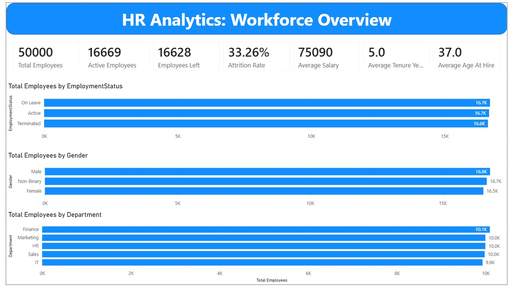
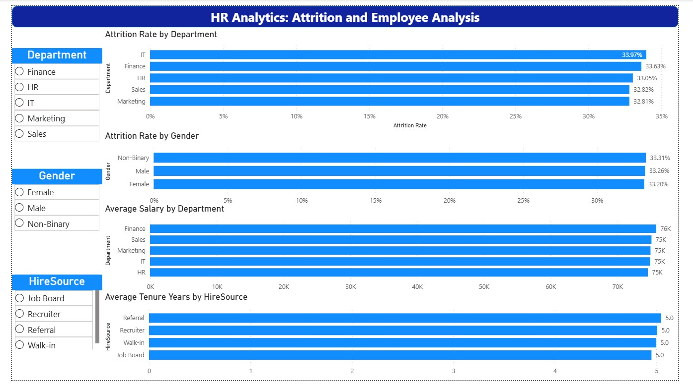
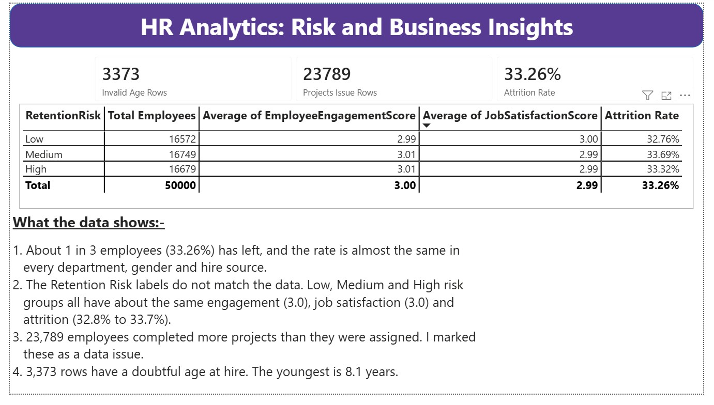

# HR Analytics — Workforce & Attrition Analysis

An end-to-end analysis of a 50,000-employee HR dataset, taken through four tools: **Excel → Python → SQL → Power BI**. The goal was to understand the workforce, measure attrition, and find out what (if anything) drives people to leave.

**Headline result:** about 1 in 3 employees in the file has left, but no factor in the data explains who leaves. Every group comparison is flat, 0 of 30 statistical tests are significant, and two prediction models perform no better than guessing. The data also has six quality problems that are flagged rather than silently fixed. Details are in [`06_project_documentation/02_Business_Insights.md`](06_project_documentation/02_Business_Insights.md).

---

## Dashboards

| Workforce Overview | Attrition & Employee Analysis | Risk & Business Insights |
|---|---|---|
|  |  |  |

## Key findings

- **Attrition is 33.26%** (16,628 of 50,000 employees terminated; 16,669 active; 16,703 on leave). This is the share of everyone *ever hired* in 2015–2025, not a yearly rate. Measured per year on opening headcount, exits rise from about 5% (2016) to about 15% (2024).
- **Attrition is the same everywhere:** 32.8%–34.0% across departments, 33.2%–33.3% across genders, and no meaningful difference by hire source.
- **No driver found.** 30 factors tested against attrition (Mann-Whitney / chi-square, Bonferroni-corrected): none significant. Logistic regression and random forest both reach an AUC of about 0.50 (coin flip).
- **The `RetentionRisk` label does not work:** "High" risk employees left at 33.3% and "Low" risk at 32.8%, with the same engagement and satisfaction scores.
- **Pay is flat:** about 1.7% spread between departments, under 0.4% between genders, and no link between performance rating and salary (correlation −0.005).
- **Reasons for leaving** split evenly (layoff, retirement, resignation, about 25% each) and are missing for about 26% of leavers.

## Data quality issues found (flagged, not deleted)

| # | Issue | Size |
|---|---|---|
| 1 | Age at hire under 16 (youngest 8.1) | 3,373 rows |
| 2 | `ProjectsCompleted` greater than `ProjectsAssigned` | 23,789 rows (47.6%) |
| 3 | `PromotionCount` > 0 but no `LastPromotionDate` | 20,805 rows |
| 4 | `SupervisorID` maps to many names (1,000 of 1,000 IDs), so it is unusable as a key | whole column |
| 5 | `YearsAtCompany` disagrees with hire/termination dates (correlation about 0.005) | about 66% of rows differ by over 2 years |
| 6 | "Retirement" exits have the same median age (about 39) as all other exits | 4,144 rows |

The dataset looks synthetic (randomly generated), so the honest conclusion is that it contains no actionable HR story. The project is built to show a sound method and clear reporting rather than to manufacture a pattern.

## Project structure

```
08_HR-Analytics/
├── 01_raw_data/            HR_raw_data.csv             original file, untouched
├── 02_excel/               HR_Initial_Analysis.xlsx    first pass: data-quality formulas, summary tables
├── 03_python/              HR_Analysis.ipynb           cleaning, EDA, attrition-driver analysis
│                           HR_cleaned_data.csv         cleaned + flagged dataset (single source of truth)
├── 04_sql/                 HR_Analysis.sql             MySQL schema, KPIs, CTEs, window functions, views
├── 05_powerbi/             hr_analytics_dashboards.pbix, 3 dashboard screenshots
├── 06_project_documentation/
│                           01_Business_Brief.md, 02_Business_Insights.md, 03_Data_Dictionary.md
└── requirements.txt
```

## How each tool was used

| Tool | What was done |
|---|---|
| **Excel** | Loaded 50,000 rows, converted dates, formula-based data-quality checks (`COUNTBLANK`, `COUNTIF`, `SUMPRODUCT`), summary tables with `COUNTIFS` / `AVERAGEIF` |
| **Python** | Date conversion, five data-quality checks, flag columns, EDA for nine business questions, then statistical tests, predictive models, yearly exit rates and tenure checks |
| **SQL (MySQL)** | Table design, validation queries, KPI and department queries, then CTEs, window functions and reusable views |
| **Power BI** | Three dashboards: workforce overview, attrition by group (with slicers), and risk/data-quality insights |

## How to reproduce

1. Install the libraries: `pip install -r requirements.txt`
2. Open `03_python/HR_Analysis.ipynb` and run all cells. It reads `../01_raw_data/HR_raw_data.csv` and writes `HR_cleaned_data.csv`.
3. For SQL, run `04_sql/HR_Analysis.sql` in MySQL. Set `local_infile` on and update the file path in the `LOAD DATA` step.
4. Open `05_powerbi/hr_analytics_dashboards.pbix` in Power BI Desktop. If the data source path breaks, point it at `03_python/HR_cleaned_data.csv`.

## Limitations

- Synthetic-looking data: group differences are all close to zero, so the conclusions describe this file, not real workforces.
- Flagged rows are kept in the data. Analyses that use age at hire should exclude `AgeAtHireFlag = 1`.
- The yearly exit-rate rise may come from how termination dates were generated. It should be confirmed with the data owner.
- Column meanings are inferred from names (see the data dictionary).
